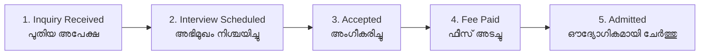

# Digital Admissions & Lead Management CRM

**Implementation Status:** ✅ Complete & Production Ready  
**Date:** October 11, 2026  
**Module:** Krypton Admissions & CRM Suite (`@krypton/web`, `@krypton/types`, & `@krypton/api`)

---

## 1. Executive Summary

The **Digital Admissions & Lead Management CRM** enables schools to maximize new student enrollments, streamline parent applications, and manage lead conversions with an enterprise-grade visual pipeline.

It solves three critical bottlenecks in school admissions:
1. **Paperless Online Applications**: A frictionless, multi-step public portal for parents to fill child details and instantly upload birth certificates and student passport photographs.
2. **Visual 5-Stage Kanban CRM Board**: An interactive drag-and-drop pipeline for school administrators to track and advance applicants from initial inquiry to official enrollment.
3. **Automated Parent Communication**: Instant WhatsApp and SMS confirmations, interview scheduling invites, offer letters, fee receipts, and official student admission slips.

---

## 2. Five-Stage Kanban Pipeline

The admissions CRM enforces a 5-stage lifecycle matching standard school governance:

1. **Inquiry Received (പുതിയ അപേക്ഷ)**:
   - Captures leads from the Online Web Portal, Front-Desk Walk-ins, WhatsApp Campaigns, and Referrals.
   - Verifies uploaded Birth Certificate and Student Passport Photo.
2. **Interview Scheduled (അഭിമുഖം നിശ്ചയിച്ചു)**:
   - Calendar date & time picker, panel/interviewer allocation, and campus venue or virtual Google Meet link.
   - 1-click WhatsApp interview reminder dispatch in Malayalam & English.
3. **Accepted (അംഗീകരിച്ചു / സീറ്റ് ഉറപ്പിച്ചു)**:
   - Admission committee assessment scores (e.g. 94/100).
   - Generates digital seat offer letter with deadline for fee payment.
4. **Fee Paid (ഫീസ് അടച്ചു)**:
   - Records admission and term 1 tuition fee payments via UPI, NetBanking, Card, or Cash.
   - Generates formal fee receipt number (e.g. `RCP-2026-4091`).
5. **Admitted (ഔദ്യോഗികമായി ചേർത്തു)**:
   - Generates official school admission number (e.g. `KPS-2026-1044`).
   - Assigns Class & Section (e.g. Grade 1 - Section B) and roll number.
   - Issues digital student ID and sends welcome kit confirmation to parent.

---

## 3. Route & Component Registry

| Route / Component | Description |
|---|---|
| [`/admissions/apply`](file:///c:/SchoolManagement/apps/web/src/app/admissions/apply/page.tsx) | Public parent application portal with multi-step form and document uploader |
| [`/admissions/track`](file:///c:/SchoolManagement/apps/web/src/app/admissions/track/page.tsx) | Live application status lookup with visual 5-stage timeline tracker |
| [`/school/admissions`](file:///c:/SchoolManagement/apps/web/src/app/school/admissions/page.tsx) | Admin Kanban Board with drag-and-drop pipeline and funnel metrics |
| [`/admin/admissions`](file:///c:/SchoolManagement/apps/web/src/app/admin/admissions/page.tsx) | Platform Admin admissions management dashboard |
| [`OnlineAdmissionPortal.tsx`](file:///c:/SchoolManagement/apps/web/src/components/admissions/OnlineAdmissionPortal.tsx) | Public portal UI with photo/birth certificate uploads, validation, and tracking |
| [`AdmissionKanbanBoard.tsx`](file:///c:/SchoolManagement/apps/web/src/components/admissions/AdmissionKanbanBoard.tsx) | HTML5 Drag-and-drop Kanban Board with interview/payment/enrollment modals |
| [`admissions-client.ts`](file:///c:/SchoolManagement/apps/web/src/lib/admissions-client.ts) | Client data store, LocalStorage sync, WhatsApp link generator, and analytics |
| [`/api/admissions`](file:///c:/SchoolManagement/apps/web/src/app/api/admissions/route.ts) | Next.js REST API for application submissions and query filtering |
| [`AdmissionsModule`](file:///c:/SchoolManagement/apps/api/src/modules/admissions/admissions.module.ts) | NestJS backend API controller, service, and data layer |
| [`admissions.ts`](file:///c:/SchoolManagement/packages/types/src/admissions.ts) | Shared TypeScript models, enums, stages, and validation contracts |
