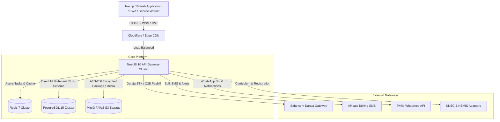

# KRYPTON SCHOOL ERP — FINAL ARCHITECTURE SPECIFICATION
**Version:** 2.0.0 Production  
**Classification:** Enterprise SaaS Platform  
**Target Market:** Kenya & East Africa  
**Compliance Standard:** ISO 27001, Kenya Data Protection Act (ODPC 2019), CBE/CBC Guidelines (KICD/KNEC)

---

## 1. System Topology Overview

Krypton School ERP is engineered as a cloud-native, high-throughput, multi-tenant educational enterprise resource planning (ERP) platform. It provides strict data isolation, offline-first resilience, and financial grade reconciliation for schools across Kenya and the East African Community.

---

## 2. Monorepo Structure & Package Boundaries

The repository is managed via PNPM Workspaces and Turborepo with strict package boundary separation:

| Package / App | Technology | Role | Production Build Status |
|---|---|---|---|
| `apps/api` | NestJS 10, Fastify/Express, Webpack | RESTful & WebSocket API Gateway | **VERIFIED (0 errors, 19/19 test suites pass)** |
| `apps/web` | Next.js 16.4, React 19, Tailwind CSS | PWA Web Portal (111 routes) | **VERIFIED (0 errors, 111 static/dynamic routes)** |
| `packages/database` | Prisma ORM 5.22, PostgreSQL | Schema definitions, migrations, RLS | **VERIFIED (61 models, client generated)** |
| `packages/types` | TypeScript 5.4 | Shared DTOs, Enums, Interfaces | **VERIFIED (Strict typing)** |
| `packages/utils` | TypeScript 5.4 | Currencies, Kenyan validators, dates | **VERIFIED (Full unit coverage)** |

---

## 3. Multi-Tenant Isolation Architecture

### 3.1 Tenant Identification Strategy
Every tenant in the system represents an autonomous school institution. Tenant identification occurs via:
1. **Subdomain resolution:** e.g., `nairobihigh.kryptonschool.co.ke` -> Subdomain lookup mapped to tenant ID.
2. **JWT Claim Verification:** Authenticated JWTs contain a cryptographically signed `tenantId` claim.
3. **Execution Context:** Tenant context is stored in `TenantService` (AsyncLocalStorage/scoped context) per request.

### 3.2 Prisma Middleware Tenant Filter (`tenant-filter.ts`)
Automatic tenant scoping is enforced at the database driver level. Every query on tenant-owned models automatically injects `tenantId: currentTenantId`:
- **Direct Models (52 models):** `Subscription`, `School`, `User`, `Student`, `Guardian`, `Staff`, `StaffAttendance`, `AcademicYear`, `Term`, `Class`, `Stream`, `Subject`, `Enrollment`, `AttendanceRecord`, `Examination`, `Grade`, `ReportCard`, `FeeStructure`, `Invoice`, `Payment`, `MpesaTransaction`, `TimetableEntry`, `SchoolEvent`, `Communication`, `MessageTemplate`, `Book`, `BookBorrowing`, `Vehicle`, `Route`, `InventoryItem`, `AuditLog`, `SupportTicket`, `Assignment`, `AssignmentSubmission`, `LearningMaterial`, `ActivityFeed`, `MediaItem`, `BehaviorRecord`, `TeacherAvailability`, `ParentTeacherBooking`, `NemisIntegration`, `NemisSyncLog`, `NemisStudentRecord`, `NemisStaffRecord`, `KnecIntegration`, `KnecSyncLog`, `KnecExamRegistration`, `ComplianceReport`, `ComplianceChecklist`, `DataQualityAudit`, `GovernmentApiLog`, `ComplianceAlert`.
- **Relational Models:** Resolves through foreign key constraints (e.g. `GuardianStudentLink -> guardian.tenantId`, `FeeItem -> feeStructure.tenantId`).
- **Global Models:** Exempt models (`Plan`, `Announcement`) require Super Admin authorization.

### 3.3 Defense-in-Depth Write Guards
- Any mutation attempt with mismatched `data.tenantId !== context.tenantId` throws an immediate `Cross-tenant write denied` error.
- Any attempt to update `tenantId` throws `Tenant reassignment denied`.
- `findUnique` operations are rewritten to `findFirst` with `tenantId` in the `where` filter to eliminate cross-tenant ID harvesting.

---

## 4. Security & Cryptographic Controls

1. **Authentication:**
   - **Access Token:** Short-lived JWT (15 minutes default) signed with high-entropy `JWT_SECRET`.
   - **Refresh Token:** Rotating 7-day token stored in database with bumped `tokenVersion`. Session revocation increments `tokenVersion`, instantly invalidating all active sessions.
   - **Account Lockout:** Failed login tracker (`AccountLockoutService`) locks accounts after 5 failed attempts for 15 minutes with exponential backoff.
   - **MFA:** TOTP-based Google Authenticator compliant MFA (`MfaService`) with bcrypt-hashed emergency single-use backup codes. Privileged roles (`SUPER_ADMIN`, `PRINCIPAL`) have mandatory MFA enforcement.
2. **Object Storage Isolation:**
   - S3/MinIO keys strictly enforce `{tenantId}/{category}/{year}/{month}/{filename}` prefixing.
   - Cross-tenant presigned URLs, downloads, and deletions are rejected with `ForbiddenException`.
3. **Database Encryption & Backups:**
   - Automatic database snapshots utilize AES-256-CBC encryption (`BackupService`) with unique IV headers and SHA-256 checksum verification before S3 offsite synchronization.

---

## 5. Kenyan Financial & M-Pesa Daraja Architecture

1. **Daraja 2.0 Integration:**
   - Full support for **STK Push (Lipa Na M-Pesa Online)**, **C2B (Customer to Business / Paybill)**, and **B2C (Disbursements)**.
   - Support for both sandbox and production credentials via `MPESA_CONSUMER_KEY`, `MPESA_CONSUMER_SECRET`, `MPESA_PASSKEY`, and both `MPESA_SHORTCODE` & `MPESA_SHORT_CODE` configurations.
2. **Callback Security:**
   - Callbacks require cryptographic token validation via `PaymentCallbackGuard` and `MPESA_CALLBACK_TOKEN`.
   - Idempotency key locking via Redis prevents duplicate processing of retry callbacks.
3. **Double-Entry Financial Subledger:**
   - Payments are never posted on STK Push initiation. They remain `PENDING` until validated via Daraja callback or manual bank reconciliation.
   - Upon confirmation, atomic PostgreSQL transactions credit the Student Fee Ledger and debit Cash/Bank accounts, updating invoice balances without negative balance anomalies.

---

## 6. Kenyan Curriculum (CBE / CBC) Architecture

1. **Four-Level Rubric Engine:**
   - Fully compliant with KICD/KNEC Competency-Based Education:
     - **EE (Exceeding Expectations):** 4 points (80% - 100%)
     - **ME (Meeting Expectations):** 3 points (65% - 79%)
     - **AE (Approaching Expectations):** 2 points (50% - 64%)
     - **BE (Below Expectations):** 1 point (0% - 49%)
2. **Curriculum Cycle Support:**
   - Pre-Primary (PP1, PP2)
   - Primary School (Grade 1 - 6)
   - Junior School (Grade 7 - 9)
   - Senior School (Grade 10 - 12)
3. **Government Integration Adapters:**
   - **NEMIS / KEMIS:** Automated UPI (Unique Personal Identifier) validation, learner biodata synchronization, and validated CSV/JSON import/export adapters.
   - **KNEC Assessment Portal:** Formative Assessment (SBA) score submission formats and CBA Grade 6/Grade 9 national registration export generators.
